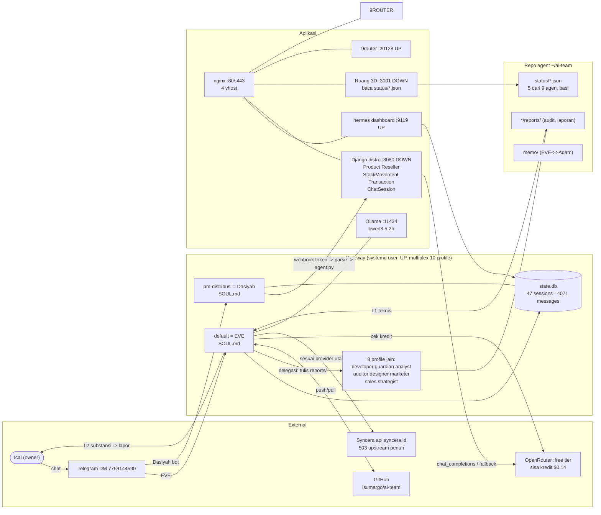
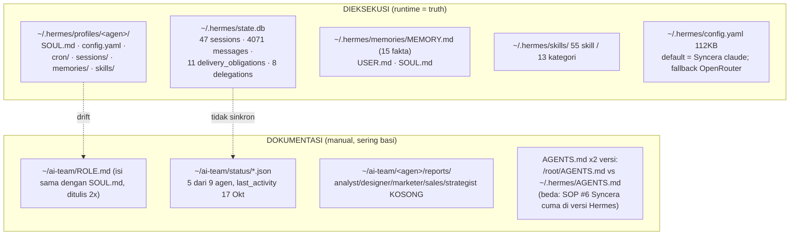

# Truth Map — AI Team Ical
> Peta sumber kebenaran, alur kerja, dan resource VPS. 
> **Versi visual:** `truth-map.excalidraw` (impor ke excalidraw.com — bisa diedit di UI, aku bisa baca JSON-nya balik).
> **Versi teks (canonical):** file ini. Edit teks/mermaid di sini, bilang aku kalau mau aku re-sync ke excalidraw.
> Terakhir diaudit: 2026-10-28.

## 1. Alur kerja utama (workflow)

## 2. Resource VPS (Hostinger, 96G disk, RAM 7.7G, 2 core)

| Service | Port | Systemd | Status | URL |
|---|---|---|---|---|
| nginx | 80/443 | nginx.service | UP | 4 vhost |
| Hermes gateway | — | hermes-gateway.service (user) | UP (7+ hari) | — |
| Hermes dashboard | 9119 | hermes-dashboard.service | UP | hermes.raminesia.com |
| 9router | 20128 | 9router.service | UP | 9router.raminesia.com |
| Ollama | 11434 | ollama.service | UP | local only |
| Monarx scanner | 65529 | monarx-agent.service | UP | local only |
| **Django distro** | 8080 | (manual, 2 proses zombie) | **DOWN** | distro.raminesia.com -> 502 |
| **Ruang 3D** | 3001 | ruang.service (user, mati) | **DOWN** | mc.raminesia.com -> 502 |
| SSH | 22 | sshd | UP | — |

## 3. Repo git

| Path | Remote | Catatan |
|---|---|---|
| `~/ai-team` | github.com/isumargo/ai-team | main ↔ origin/main; push terakhir 23 Okt; 5 file tertunda |
| `~/.hermes/hermes-agent` | github.com/NousResearch/hermes-agent | fork lokal v0.22.2, blob:none (sparse) |
| `~/.local/share/ruang` | github.com/yugienugraha/ruang | clone Ruang 3D office |

## 4. Struktur data — sumber kebenaran

| Temuan | Detail |
|---|---|
| Duplikasi | `ROLE.md` vs `SOUL.md` — konten sama, bisa beda isi |
| Bolong | 4 agen tanpa status.json (analyst, designer, marketer, sales, strategist) |
| Duplikasi config | `profiles/developer/config.yaml` = salinan utuh main config (109KB) |
| AGENTS.md | 2 versi berbeda; SOP hemat-kuota (#6) cuma ada di `~/.hermes/` |

## 5. Otomasi cron (no_agent, 0 token)

| Job | Interval | Script | Output |
|---|---|---|---|
| guardian-openrouter-check | 30 menit | `ai-team/guardian/check_usage.py` | status/guardian.json + usage-alert.md; auto-switch model saat limit |
| guardian-backup | 6 jam | `ai-team/guardian/backup.py` | `/root/backups/*.tar.gz` (13 file, 189/200MB — mepet; belum exclude venv) |
| session-monitor-v2 | 15 menit | `ai-team/guardian/session_monitor.py` | monitor sesi |

## 6. Routing model saat ini

| Agen | Utama | Fallback |
|---|---|---|
| default (EVE) | Syncera `claude-opus-4-20250514` (503) | OpenRouter `minimax-minimax-m3.1-flash:free` |
| 8 profile | OpenRouter `nemotron:free` | OpenRouter `inkling:free` |
| pm-distribusi (Dasiyah) | OpenRouter `inkling:free` | `inkling:free` |
| OpenRouter kredit | $9.86 / $10 terpakai — sisa $0.14; limit guardian $5 sudah lewat (alert SWITCHED) | |
| Limit tertulis | 3 sumber beda: AGENTS.md $5 · check_usage.py $5 · MEMORY.md $20 | |

## 7. Aturan SOP (singkat)

1. Retry maks 3x; output padat; baca file efisien (grep/head).
2. Semua hasil kerja agen -> Auditor (L1 teknis) -> EVE (L2 substansi) -> Ical.
3. Komunikasi antar-agen via file `~/ai-team/`, bukan chat.
4. Selesai kerja -> push GitHub (terakhir 23 Okt = bolong).
5. Higiene memori: **dilarang** catat nama model AI di MEMORY/SOUL/ROLE/status/laporan (saat ini dilanggar di beberapa file).
6. Hemat request Syncera: 550 req/5 jam; subagent mahal; 429 = STOP.
